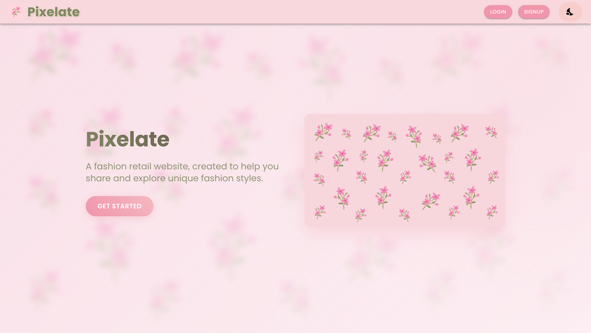
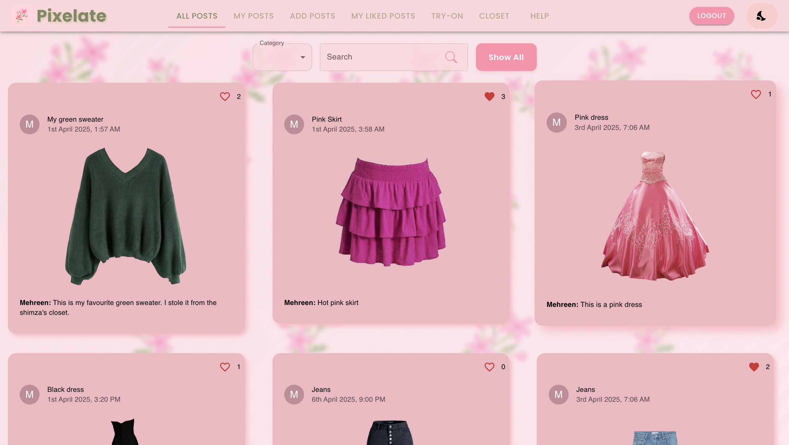
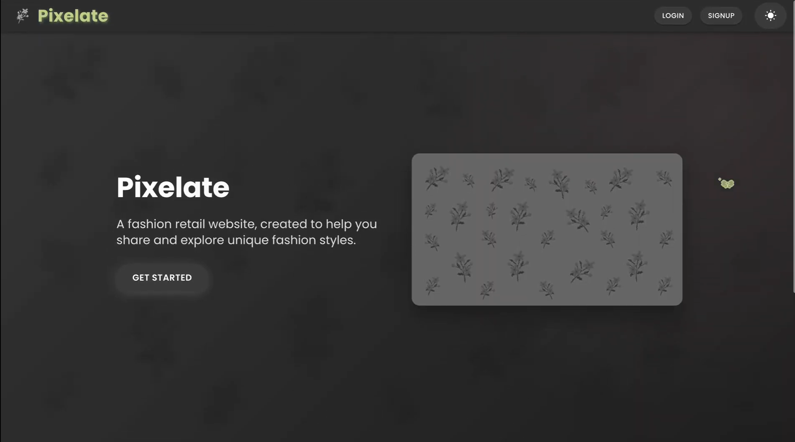
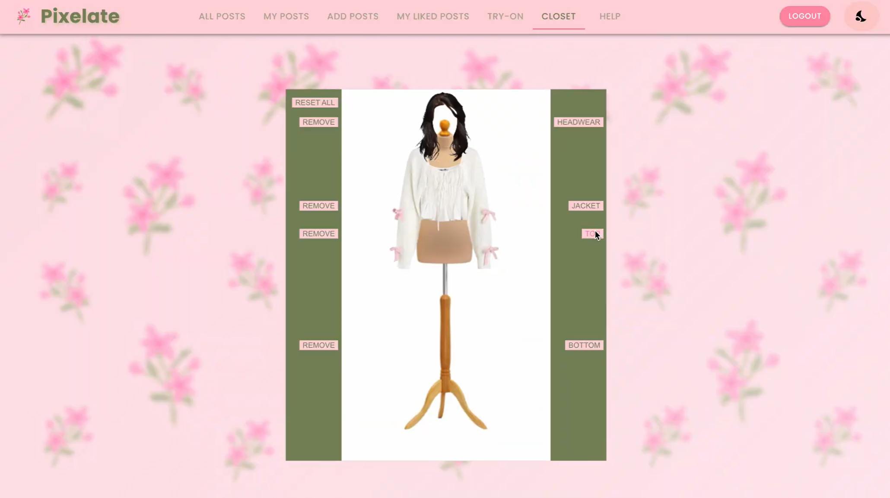
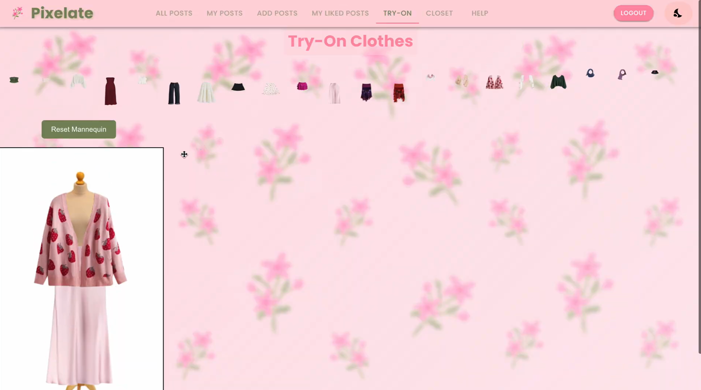

# Pixelate

## Overview

Pixelate is a fashion retail web application that enables users to create, share, and interact with fashion content. Users are able to post outfits, like, and comment on others’ posts. Post filtering options are also available. Additionally, the web application features two virtual try-on modes for enhanced user experience.

## Prerequisites

Before you start, ensure that you have the following installed on your computer:

- [Node.js](https://nodejs.org/) (which includes npm)
- A code editor like [VS Code](https://code.visualstudio.com/)

## Getting Started

1. **Clone the repository** or download the project files to your local machine.
    ```bash
    git clone https://github.com/muskanmorshed/pixelate.git
    cd pixelate
    ```
## Backend
1. **Navigate to the backend directory**:
   ```bash
   cd backend
    ```
2. **Install dependencies**:
    ```bash
    npm install
    npm install framer-motion @dnd-kit/core moment-timezone
    ```
3. **Start the backend server**:
    ```bash
    npm start
    ```
This will start the backend server.

## Frontend
Open a new terminal:
1. **Navigate to the frontend directory**:
    ```bash
    cd frontend
    ```
2. **Install dependencies**:
    ```bash
    npm install
    npm install framer-motion @dnd-kit/core moment-timezone
    ```
3. **Start the frontend server**:
    ```bash
    npm start
    ```
This will open the frontend web application in your browser.

## To Run tests
    npm test

## Troubleshooting
- If you encounter issues with the backend, make sure that you have the correct environment variables set up.
- If the frontend does not open automatically, try navigating to `http://localhost:3000` or `http://localhost:3001` manually in your browser.

## Future Improvements
- More clothing options for the try-on feature and closet
- Deploy website so that is accessible online
- Posts can be deleted from `All Posts` page

## Screenshots
<div style="display: flex; justify-content: center; flex-wrap: wrap;">
    
    
</div>

<div style="display: flex; justify-content: center; flex-wrap: wrap;">
    
    
    
</div>
Landing page, All Posts page, Dark mode on landing page, Closet feature, Try-On Feature


## Authors:
- Malasa Khan
- Mehreen Morshed
- Muskan Morshed
- Shimza Warraich
